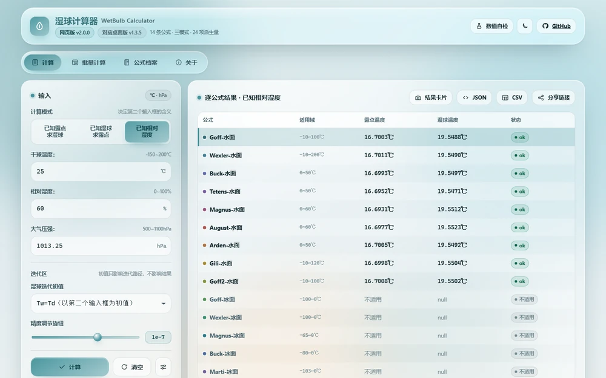
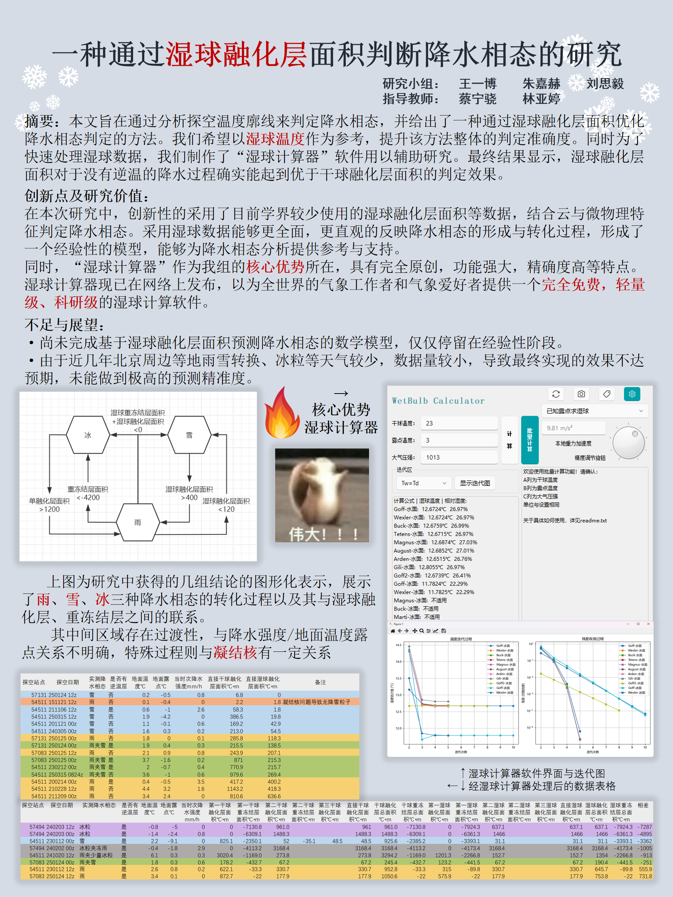

# WetBulb Calculator (湿球计算器)

> 科研级气象参数计算工具 | 支持 14 种国际公式 | 可视化迭代过程 | 支持批量计算


[English version →](README.en.md)

开发团队：RDFZ 降水相态研究性学习小组

---

## ⚡ 30 秒试一下

**不用装 Python，也不用下载。** 直接打开
**[网页版 → navi.x1shang.top/wetbulb](https://navi.x1shang.top/wetbulb/)**：
页面默认是「已知露点求湿球」、`25 ℃ / 露点 15 ℃ / 1013.25 hPa`，点「计算」就能看到
14 条公式的逐条结果；超出注册域的公式会写明「不适用」。

三种模式、单位换算、批量导入导出与迭代可视化都在网页里。全部计算在本机浏览器完成，
数据不上传，手机 / 平板也能直接用。

> 要命令行或离线 exe？到 [Releases](https://github.com/x1shang/Wetbulb-Calculator/releases)
> 下载 `WetBulbCLI-*.exe`（零第三方依赖），用法见下方「命令行」。

**想先确认它算得准不准？** → [`docs/精度与参考文献.md`](docs/精度与参考文献.md)：14 条公式在各自注册区间上的实测偏差表、五方独立参照（IAPWS-95 / Murphy & Koop 2005 / WMO 表 / ASHRAE / Stull 2011）、以及**明写的已知局限**。

**算得不对、或想加一条公式？** → [开一个 Issue](https://github.com/x1shang/Wetbulb-Calculator/issues/new/choose)，模板会问我要的四件事（场景 / 期望值与依据 / 实际结果 / 版本）。能复现的算例我会直接加进 `tests/` 当回归用例。

---

## 🌡️ 适用温度区间（实测）

输入框允许 −150~200 ℃，但这不是每条公式都能算的范围。实测「至少一条公式给出数值」：

| 条件 | 可算出数值的干球温度 |
|---|---|
| 默认：模式「已知露点求湿球」、25 ℃ / 露点 15 ℃ / 1013.25 hPa | **15 ℃ < T ≤ 199.9393 ℃** |
| 三种模式合起来（任一模式有数值）、第二输入取遍合法值、500~1100 hPa | **−103 ℃ ≤ T ≤ 200 ℃** |

下限由 `Marti-冰面` 的 −103 ℃ 决定（在「已知相对湿度」模式可取到；露点/湿球模式只能无限接近），
上限由 `Wexler-水面` 的 200 ℃ 决定（常压下需把 RH 降到约 6% 以下，否则水汽分压超过总压）。默认点 25 ℃ / 露点 15 ℃ 下 14 条公式中 9 条可用，
其余 5 条冰面公式因干球/露点高于 0 ℃ 自动标「不适用」。
详见 [精度与参考文献](docs/精度与参考文献.md#已知限制)。

---

## 项目简介
湿球计算器是一款基于气象学公式的图形化工具，用于计算湿球温度、露点温度及相关气象参数。支持多种饱和水蒸气压力计算公式，提供单位转换、迭代过程可视化及详细参数分析功能。
本项目作为我们降水相态的温度廓线研究的子项目，为主项目提供了强大的技术支持。提供本软件即旨在提供各类气象学研究的得力工具。

## 🔥 不只是一个湿球计算器。

- **三种模式**：已知露点求湿球、已知湿球求露点、已知相对湿度求两者。
- **14 种公式**：支持单位转换、迭代可视化与扩展参数。
- **批量计算**：Excel 输入，非法行显示错误单元格，其他行继续计算。
- **命令行接口**：无需打开 GUI，输出 JSON，便于脚本集成。
- **网页版**：`web/index.html` 单文件，双击即用、离线可用、数据不出本机（见下）。

计算范围、实测精度、定义差异及参考文献统一见 [精度与参考文献](docs/精度与参考文献.md)。
历史版本变化见 [项目编年史](docs/项目编年史.md)。

---

## 🌐 网页版（v2.0.0）

不想装 Python、也不想下载 exe？直接开 **[navi.x1shang.top/wetbulb](https://navi.x1shang.top/wetbulb/)**，
或者用 [`web/index.html`](web/index.html) 这个 **230 KB 的单文件网页版**：
双击就用，离线可用，全部计算在本机浏览器里完成（不上传任何数据）。
Releases 里也提供同内容的 [`WetBulbCalculator-web-*.html`](https://github.com/x1shang/Wetbulb-Calculator/releases)，
与两个 exe 一起校验 SHA256。




- **数值内核与桌面版逐点对拍**：`web/src/core.js` 是 `src/core.py` 的移植。
  页面上有个「数值自检」按钮，点一下就用**由真 core.py 生成的** 351 项黄金向量就地重算并比对；
  `tests/test_web_parity.py` 另用 1035 组用例（14 条公式 × 三模式 × 温压扫描 + 派生量 + 错误文案 + 格式化）
  与现算的 core.py 逐点对拍，连**显示串**（4 位小数）都比。
  单位换算与批量规则不在这条对拍的范围里（它们在 `ui.js` 与 `main.py`/`batch.py` 各有一份），
  由 `tests/test_web_ui_parity.py` 单独守。
- **版本号怎么读**：网页版用 `2.x.y`、桌面版用 `1.x.y`，两者**刻意不同号**。
  网页版 `v2.0.0` 对应桌面版 `v1.3.5`；桌面版升到 `1.3.6` 时，网页版内核跟进记作 `2.0.1`。
  这样一眼能看出"网页版是不是落后了"。
  **但 git tag 只有桌面版这一套**（`v1.x.y`）：网页版的 `2.x.y` 不单独打 tag，写在同一次 Release
  的说明里 —— 一个仓库挂两套 tag 比混号更容易让人迷路，而且 `release.yml` 会校验
  `tag == core.tag`，网页版的号根本推不上去。
- **覆盖范围**：三种模式、14 条公式与"不适用"判定、单位换算（℃/K/℉ × Pa/hPa/mmHg/cmHg/bar）、
  精度调节、迭代可视化（可交互、可导出 PNG）、24 项常用气象参数、公式档案、
  CSV/XLSX 批量导入导出（沿用 A/B/C 列与 `#VALUE!` 规则）、结果卡片 PNG、JSON/CSV 导出、
  分享链接、本地记忆。
- **界面**：液态玻璃风格重做（桌面版受 PySide2 布局约束），但术语、模式名、单位、
  状态文案与桌面版一一对应；有意不同的地方在网页版「关于」里逐条列出。
- **它是桌面版的子集，不是等价物**。已知且有意保留的三处不等价（都只影响**导出的文件**，
  不影响任何计算结果）：批量导出的结果被截到 4 位小数、只保留 A/B/C 三列（D 列及其后会丢失）、
  `#VALUE!` 写成文本而非 Excel 错误值。另有**命令行接口**是桌面版独有的 ——
  要脚本调用请用 `WetBulbCLI-*.exe`。这几条也写在网页版「关于」页里。

### 网页版的构建与验证

源码按职责分成 5 份（`shell.html` 是骨架），构建成单文件（与 `build.ps1` + spec 的关系是同一个套路）：

```powershell
python scripts/export_vectors.py                     # core.py → web/src/vectors.js（自检向量）
python scripts/build_web.py                          # web/src/* → web/index.html（单文件）
python scripts/export_vectors.py --check             # CI：自检向量是否落后于 core.py
python scripts/build_web.py --check                  # CI：构建产物是否落后于源码
python -m pytest tests/test_web_parity.py -q         # 数值对拍（本机无 node 时 skip）
python -m pytest tests/test_web_ui_parity.py -q      # 单位换算 / 批量规则的跨实现对拍
python -m pytest tests/test_web_e2e.py -q            # 真浏览器端到端（需 playwright + chromium）
```

`build.ps1` 会先跑两个 `--check`，再把 `web/index.html` 拷进 `dist/` 作为第三个发行资产 ——
**`web/index.html` 入库**是这个仓库里"构建产物不入库"的唯一例外，理由与三道闸写在
`.gitignore` 与 `.gitattributes` 的注释里（其中 `-text` 是为了让交付物在任何平台检出后字节一致）。

改 `src/core.py` 的数值后必须同步 `web/src/core.js`，否则
`tests/test_web_parity.py` 会红 —— 这正是它存在的理由。
改 `main.py` 的单位换算或 `src/batch.py` 的列规则后必须同步 `web/src/ui.js`，
否则 `tests/test_web_ui_parity.py` 会红 —— 那一条守的是"核心完全正确、只有用户看到的数字错"。

---

## 安装与运行

从 [Releases](https://github.com/x1shang/Wetbulb-Calculator/releases) 下载正式版。
GUI 资产为 `WetBulbCalculator-v1.3.4.exe`，命令行资产为 `WetBulbCLI-v1.3.4.exe`。
同页提供 `example.xlsx`、LICENSE、第三方声明和 SHA256SUMS.txt。

### 1.3.4 更新内容！

- **更正**：查得「纪利公式」（原误称"吉利公式"）的原始文献，并更正 v1.3.1 对该式的根因记述——
  真正的错是指数常数被抄成原文的 1/10，**前因子 980.66 本来就对**。
- **新增**：纪利公式适用域上界 20 ℃ → **120 ℃**（下界仍为 −10 ℃），20~120 ℃ 现在会给出结果。
  本版**唯一的行为变更，且是纯新增**（没有温度失去可用性）。
- **未改数值**：本版没有任何数值修复；已逐点对拍 v1.3.3（14 条公式 × 701 点，0 处不同）。
- **验证**：新增纪利公式与 Goff-Gratch 在各自参考点上的自洽性断言。
- **文档**：精度与参考文献补全书目与证据等级，编年史新增 2026-10 出处复核一节。

### 源码运行

GUI 使用 **Python 3.10**；核心与 CLI 无第三方依赖，CI 验证 Python 3.10 / 3.12。

```powershell
python -m pip install -r requirements.txt
python main.py
```

Fluent Widgets 用于按钮、输入框、提示条等控件，必须安装；`colorthief` 和 `scipy` 已显式列入依赖。

### 命令行

```powershell
python main.py --cli --mode rh --temperature 25 --value 60 --pressure 1013.25
python src/cli.py --mode dewpoint --temperature 25 --value 15
.\WetBulbCLI-v1.3.4.exe --mode wetbulb --temperature 25 --value 20
```

`--mode` 表示已知量：`dewpoint`（露点）、`wetbulb`（湿球）或 `rh`（相对湿度）。
温度为 ℃，压力为 hPa，RH 为百分数。可用 `--method "Goff-水面"` 只输出一种公式。
JSON 包含版本、模式及逐公式结果；`rh` 模式的 result1/result2 分别为露点/湿球，其余模式 result1 为所求温度。
不适用的公式保留文字状态；输入错误写入 stderr 并返回退出码 2，成功返回 0。`--version` 查看版本。

---

## 批量计算使用方法

1. 将下载的 `example.xlsx` 放在 exe 同一目录；源码运行时放在项目根目录。
2. 第一行保留 A、B、C 表头；依次填干球温度、当前模式的已知量和大气压强。
3. 在 GUI 选择模式与单位，点击批量计算。

目录中保留一个输入 xlsx；`result_` 与 `~$` 开头的文件会被忽略。
结果另存为 `result_原文件名.xlsx`，同名结果再次计算时会覆盖；输入文件不变。
输出追加结果列，非法行写入 `#VALUE!` 和“错误”原因列。采用 Goff 水面（干球 ≥0 ℃）或冰面公式。
整表完成后才写盘，中途退出需重跑。

---

## 开发与验证

```powershell
python -m pip install -r requirements-dev.txt
pwsh -File run_tests.ps1
```

核心测试比较外部参照；Windows CI 另装完整依赖并强制执行 GUI 测试。
本地缺少 GUI 环境时会明确跳过；可设置 `WETBULB_GUI_PYTHON` 指向 Python 3.10。
自动检查覆盖窗口构造、三种计算模式、批量文件与非法行；视觉效果仍需人工检查。

网页版另有两条：`tests/test_web_ui_parity.py`（纯源码扫描，零依赖，任何环境都跑）、
`tests/test_web_e2e.py`（真 Chromium，需 `pip install playwright openpyxl && playwright install chromium`）。
后者在 CI 的 `web-e2e` job 里真跑 —— 它是**唯一**覆盖界面链路的一层，看到它 skip 就说明流水线坏了。

### 打包与发布

在 **ASCII 路径**的 Python 3.10 环境安装构建依赖：

```powershell
python -m pip install -r requirements-build.txt
$env:WETBULB_BUILD_PYTHON = (Get-Command python).Source
pwsh -File build.ps1
```

`WetBulbCalculator.spec` 入库维护。构建先运行测试，再生成版本指纹，最后验证实际 exe 并输出 SHA256；
同一个脚本顺带用两个 `--check` 校验网页版并把 `web/index.html` 拷进 `dist/`，所以
**一次 release 发三个资产**：`WetBulbCalculator-*.exe`、`WetBulbCLI-*.exe`、`WetBulbCalculator-web-*.html`。
依赖和构建工具固定关键版本；不承诺不同路径或时间的产物逐字节相同。

发布顺序：commit → 新 tag → push → 检查 tests/release 工作流 → Release。
`core.tag` 必须与 tag 一致；发布任务只在构建测试通过后上传资产。
每版使用新 tag，通常不移动；历史重写例外见编年史。
Release 说明维护在 [RELEASE_NOTES.md](RELEASE_NOTES.md)。

**产物与入库政策**：`dist/` `build/` `*.exe` 一律不提交到 Git；**唯一例外是 `web/index.html`** ——
它的交付形态就是"一个 html"，不入库就失去了"在 GitHub 上点开即用"的价值。
代价由三道闸兜住：`.gitattributes` 给它加了 `-text`（让它在任何平台检出后**字节都一致**，
否则 Windows 上会变成 CRLF，交付物与 SHA256 随平台而变 —— 注意这不会让 `--check` 失败，
`build_web.py` 用文本模式读文件，CRLF 会被还原成 LF 再比）、
`test_single_file_build_is_current` 逐字节校验它没过期、`release.yml` 把它作为发行资产上传。

### 目录结构

```text
main.py             GUI 入口与 CLI 分流
src/core.py         零依赖计算核心
src/cli.py          JSON 命令行
src/batch.py        共享 Excel 计算
src/ui/            界面
web/                单文件网页版（src/ 为源码，index.html 为构建产物但**入库**）
scripts/            网页版构建（build_web.py / export_vectors.py）与打包辅助
assets/ examples/  资源与样表
tests/             核心、CLI、GUI、网页版数值对拍 / 界面链路 / 端到端回归
docs/              科学依据与历史
```

---

## 声明

本项目使用 [MIT LICENSE](LICENSE)。第三方依赖及其许可证见 [第三方声明](THIRD_PARTY_NOTICES.md)。
转发时请注明项目出处；科学计算结果应结合适用范围与独立验证使用。

> 🌈 科学计算从未如此优雅 | 让复杂的气象参数触手可及

---

## 📌 学术展板

本工具是研学课题「一种通过湿球融化层面积判断降水相态的研究」的技术支撑：课题里的湿球温度、湿球融化层面积，都由它批量算出。

课题论文（LaTeX 排版）→ [x1shang.top/academic/湿球融化层面积判断降水相态](https://x1shang.top/academic/湿球融化层面积判断降水相态/)

[](https://x1shang.top/academic/湿球融化层面积判断降水相态/)
